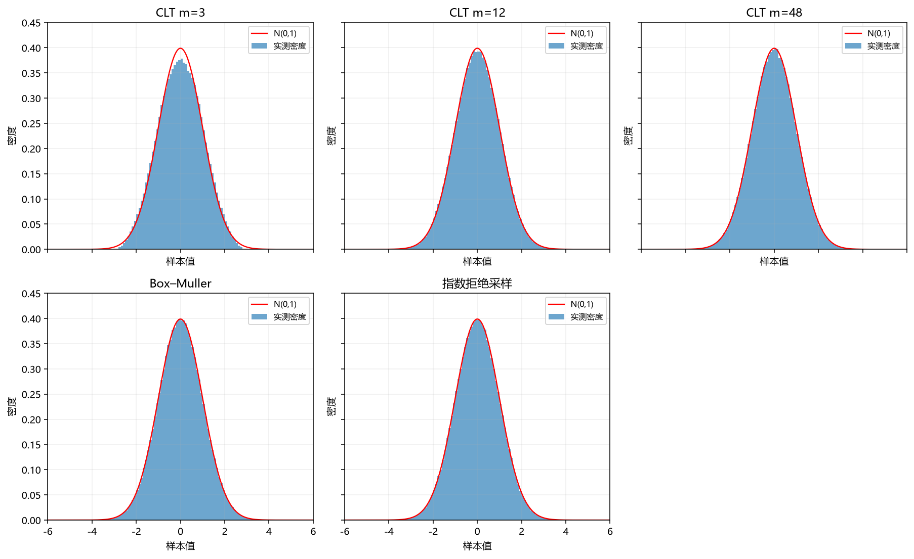
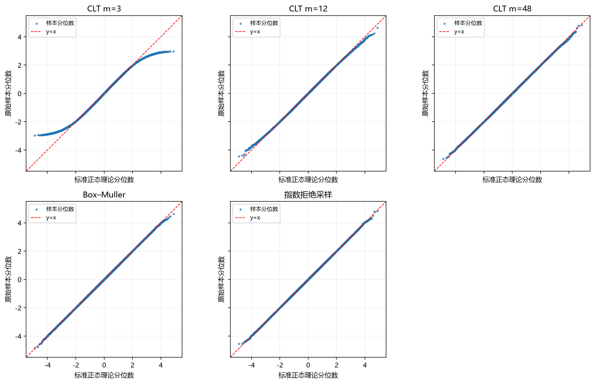
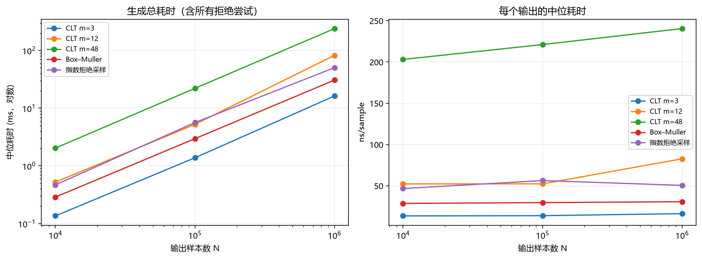

# 正态随机变量的生成：中心极限定理、Box–Muller 与指数拒绝采样

## 一、实验目的与要求

使用 C++17 自行实现三种标准正态生成方法，比较 CLT m=3、12、48，Box–Muller 和指数拒绝采样五种设置的体部、尾部及速度。输出为 double，没有调用 std::normal_distribution，没有按实测均值和方差重新标准化。

原指定 D:/random 在当前环境不存在，经用户确认使用 D:/CPP/random。前两次成品均可读取，沿用其 src/tests/tools/results/docs 目录、-O2 构建、中文 Markdown 报告和微软雅黑图表；前两次没有 PDF 导出流程，本次未生成 PDF。

## 二、算法、正确性与复杂度

### 2.1 CLT 近似法

独立抽取 m 个 U_i，计算 $Z=\sqrt{12/m}(\sum_i U_i-m/2)$。比例系数每批计算一次。在理想连续均匀模型下，$E[U_i]=1/2$、$\operatorname{Var}(U_i)=1/12$，故任意正整数 m 都有 $E[Z]=0$ 和 $\operatorname{Var}(Z)=1$。均值与方差并不能唯一确定分布。有限 m 的均匀和有界，支持闭包为 $[-\sqrt{3m},\sqrt{3m}]$，而标准正态无界；超额峰度为 $-6/(5m)$，三组理论值依次为 -0.4、-0.1、-0.025。中心极限定理描述的是 m 增大时的分布收敛。

m=3 时支持闭包为 [-3,3]，理论上不可能有 |Z|>3，本次也观察到 0 个。标准正态对应概率为 0.002699796，百万次的期望次数为 2699.796。因此即使体部接近，m=3 也不能可靠模拟正态尾部。m=12、48 的范围闭包分别是 [-6,6]、[-12,12]。

CLT 工作量为 O(Nm)，每个输出消耗 m 个均匀数。m 固定后随 N 线性，但增大 m 会增加常数成本。

### 2.2 Box–Muller

计算 $R=\sqrt{-2\log U_1}$、$\theta=2\pi U_2$，输出 $R\cos\theta,R\sin\theta$。在理想独立连续均匀输入与精确运算下，极坐标联合密度经雅可比变换为 $(2\pi)^{-1}e^{-(x^2+y^2)/2}$，即两个独立标准正态。每对的两个值均使用；奇数 N 的最后一对只写第一个值，恰好输出 N 个。复杂度 O(N)，每对消耗两个均匀数，需要对数、平方根和三角函数。

### 2.3 指数提议拒绝采样

候选 $X=-\log U_1$ 的密度是 $g(x)=e^{-x}$（x≥0）。接受概率 $a(x)=e^{-(x-1)^2/2}$ 不超过 1，并且

$$g(x)a(x)=e^{-x}e^{-(x-1)^2/2}=e^{-1/2}e^{-x^2/2}.$$

积分得接受率 $p=\sqrt{\pi/(2e)}=0.760173450533$；归一化后的已接受候选密度为 $\sqrt{2/\pi}e^{-x^2/2}$，即半正态。每次接受后另抽一个独立均匀数，以 1/2 概率赋予正负号，得到标准正态。上述精确分布结论同样以理想连续输入与精确运算为前提。

代码采用对数判据 $-2\log U_2\ge(X-1)^2$；拒绝时不写输出、不抽符号，直到接受数达到 N。本次候选 1315003，拒绝 315003，接受 1000000；两者相加等于候选总数。实测接受率 76.045453889%，理论 76.017345053%，相差 0.028109 个百分点；每输出平均候选 1.315003，理论 1.315489247。理想独立候选模型下百万次接受对应接受率的近似标准误约为 0.000372，该差异约为 0.76 个标准误。有限样本接受率不必等于理论值。

候选次数服从几何重试模型，每输出期望尝试 1/p，故为期望 O(N)；单个输出没有固定的尝试次数上限。每个候选使用两个均匀数，接受后另用一个均匀数决定符号。

## 三、环境、随机数与实验配置

实测日期：2026-11-17（Asia/Shanghai）。编译器：g++ (Rev5, Built by MSYS2 project) 16.1.0。系统：Windows-11-10.0.26100-SP0，架构 AMD64，处理器标识 Intel64 Family 6 Model 190 Stepping 0, GenuineIntel。未推断 CPU 商品型号或温度。Python：3.12.10 (tags/v3.12.10:0cc8128, Apr  8 2025, 12:21:36) [MSC v.1943 64 bit (AMD64)]；绘图复用作业一环境，numpy 2.5.4、matplotlib 3.11.2，字体 Windows 微软雅黑。

实际编译命令（工作目录 assignment-3；完整绝对路径命令另存 environment.json）：

```powershell
g++ -std=c++17 -O2 -Wall -Wextra src/driver.cpp -o build/normal.exe
g++ -std=c++17 -O2 -Wall -Wextra tests/test_normal.cpp -o build/test_normal.exe
```

三种算法共用 std::mt19937_64，均匀数为 `(double(rng() >> 12) + 0.5) * 2^-52`，共 2^52 个等概率中点，端点为 2^-53 和 1-2^-53，严格落在 (0,1)。生成循环内不重新播种。实数理论与有限网格、伪随机相关性及浮点计算有边界，程序生成的离散近似不能声称等于连续分布。固定源码、工具链、参数和种子可复现非时间输出；跨数学库不承诺逐位相同。

分布实验每组 1000000 个输出，各 seed 如下。Box–Muller 和拒绝采样记录中的 m=12 仅是统一 CLI 占位参数，不参与该算法。

| 方法 | 分布实验 seed |
|---|---|
| CLT m=3 | 17393431821124590715 |
| CLT m=12 | 1618983192877232227 |
| CLT m=48 | 12422266230042593136 |
| Box–Muller | 18301210335308144050 |
| 指数拒绝采样 | 14577427584930628428 |

正式配置 config.json：性能 N=10000、100000、1000000，每设置预热 2 次，再测量 20 次，共 300 条原始记录。主种子 2026111701，任务调度种子 2026111702。Python Random 只派生任务种子和打乱 15 个性能任务的顺序，样本全部由 C++ 引擎生成；各重复的实际 seed 保存在 raw CSV，完整命令、配置及哈希保存在 run_manifest.json。任务串行执行，每任务内部连续重复，没有主动剔除慢记录。

## 四、正确性和功能检查

PASS 23558 checks；另有 14 类 CLI 非法参数检查通过。测试覆盖固定种子复现、1/2/3/10/101/1000 个输出、输出首尾哨兵、所有输出有限和 CLT 范围。使用已知输入 U1=exp(-2)、U2=1/8 检查 Box–Muller 两个值均为 sqrt(2)。

拒绝分支注入 U1=exp(-4)、U2=0.9，确认拒绝后缓冲区仍保持哨兵；随后 U1=exp(-1)、U2=0.5 接受，符号均匀数 0.25 得到 -1，确认只写一个值、候选数=2、拒绝数=1；另测正号。测试注入序列只用于确定性分支检查，正式实验使用真实伪随机引擎。非法规模、m、方法、模式、重复/缺失/未知选项、非法整数和种子溢出均检查；含空格路径和二进制复现检查通过。统计量仅用于诊断，没有用样本均值、方差或接受率精确等于理论值作为测试条件。

快速模式已经实际执行：每组 10000 个分布样本，性能 N=100、1000，预热 1 次、测量 3 次，共 30 条计时；数据与图保存在 results/quick，未混入正式结果。正式 5000000 个输出全部检查有限性，CLT 全部检查范围；已由原始样本重算统计、候选关系及各 CSV，由原始计时重算全部中位数并核对哈希。

## 五、分布实验结果

方差采用中心二阶矩 $N^{-1}\sum(z_i-\bar z)^2$（ddof=0）；超额峰度为中心四阶矩除以方差平方再减 3，未做有限样本无偏修正。阈值使用严格大于。理论次数为期望，并非要求实测等于它。

| 方法 | 均值 | 方差 | 超额峰度 | abs(Z)>2 次数 / 比例 | abs(Z)>3 次数 / 比例 |
|---|---|---|---|---|---|
| CLT m=3 | 0.00012079 | 0.99832125 | -0.40030792 | 41478 / 4.147800% | 0 / 0.000000% |
| CLT m=12 | 0.00076913 | 1.00078345 | -0.09660443 | 44571 / 4.457100% | 2030 / 0.203000% |
| CLT m=48 | -0.00182902 | 1.00009766 | -0.03250427 | 45213 / 4.521300% | 2492 / 0.249200% |
| Box–Muller | 0.00061548 | 1.00001733 | 0.00163867 | 45601 / 4.560100% | 2680 / 0.268000% |
| 指数拒绝采样 | -0.00112853 | 1.00057174 | -0.00190697 | 45433 / 4.543300% | 2779 / 0.277900% |
| 标准正态理论 | 0 | 1 | 0 | 期望 45500.264 / 4.550026% | 期望 2699.796 / 0.269980% |



共用分箱 [-6,6]、宽度 0.1，共 120 箱；密度除以原始总数 N 与箱宽，不按落在可视范围内的样本数重新归一化。各组同坐标叠加标准正态密度。histogram.csv 保存箱计数；若有范围外样本可由总计数与 N 的差发现。



样本排序后，以秩 r 的绘图位置 (r-0.5)/N 计算标准正态理论分位数；取 1401 个线性间隔秩，加每侧尾部 1..N/100 的 300 个几何间隔秩，四舍五入去重，保留最小值和最大值。所有面板共享 [-5.5,5.5] 坐标并标注 y=x，不对样本标准化。qq.csv 保留实际秩、概率及点坐标。

CLT m=3 的体部较平，超额峰度接近 -0.4；m 增大后体部逐步接近理论密度，但 Q–Q 尾部仍可见偏离。m=12 的 |Z|>3 比例为 0.2030%，m=48 为 0.2492%，均低于正态理论约 0.2700%。Box–Muller 为 0.2680%，拒绝采样为 0.2779%，与理论较接近，差异包含有限样本波动。m=48 比 m=12 更接近理论尾部，并不意味着任意固定 seed 的每个统计量都单调改善。最极端分位点本来就有较大随机波动，不能仅凭单个点判定算法有误。

## 六、性能实验结果

采用 std::chrono::steady_clock。每任务预分配并初始化一个输出缓冲区；每次 trial 的种子初始化、分配在计时外。计时包含随机数生成、变换、写内存和拒绝采样的全部失败尝试；拒绝采样使用编译期关闭的诊断计数版本。所有算法计时后完整遍历输出，检查有限性并计算写入 CSV 的 checksum，CLT 另检查范围，防止未使用结果导致计算被删除。结果校验、统计、写盘、进程启动和绘图均在计时外。计时包含批次调用分派及 CLT 比例系数计算。

| 方法 | N | 重复 | 中位耗时 (ms) | ns/sample |
|---|---|---|---|---|
| Box–Muller | 10000 | 20 | 0.287000 | 28.700000 |
| Box–Muller | 100000 | 20 | 2.963250 | 29.632500 |
| Box–Muller | 1000000 | 20 | 30.726450 | 30.726450 |
| CLT m=3 | 10000 | 20 | 0.135450 | 13.545000 |
| CLT m=3 | 100000 | 20 | 1.380850 | 13.808500 |
| CLT m=3 | 1000000 | 20 | 16.281500 | 16.281500 |
| CLT m=12 | 10000 | 20 | 0.522850 | 52.285000 |
| CLT m=12 | 100000 | 20 | 5.238200 | 52.382000 |
| CLT m=12 | 1000000 | 20 | 82.699250 | 82.699250 |
| CLT m=48 | 10000 | 20 | 2.030900 | 203.090000 |
| CLT m=48 | 100000 | 20 | 22.109700 | 221.097000 |
| CLT m=48 | 1000000 | 20 | 240.477450 | 240.477450 |
| 指数拒绝采样 | 10000 | 20 | 0.466900 | 46.690000 |
| 指数拒绝采样 | 100000 | 20 | 5.635800 | 56.358000 |
| 指数拒绝采样 | 1000000 | 20 | 50.508200 | 50.508200 |



N=1000000 时，CLT m=3 为 16.281500 ms，Box–Muller 为 30.726450 ms，拒绝采样为 50.508200 ms，CLT m=12 为 82.699250 ms，CLT m=48 为 240.477450 ms。本机本轮按该顺序由快到慢。CLT m=3 最快但丢失正态远尾；增大 m 增加均匀数成本。Box–Muller 每两个均匀数产出两个样本，抵消了部分三角函数成本；拒绝采样需要多次候选、对数及符号抽样，其全部拒绝成本已经计入。

规模放大总体与线性工作量一致，但 ns/sample 并非严格常数，例如 CLT m=12 在最大规模更高。没有控制 CPU 频率、温度或所有后台活动，没有重复整批测量或做显著性检验；不从这些差异推断算法复杂度发生变化，也不将本轮排名推广到所有平台。

## 七、局限、复现与交付

本次每种分布只有一个百万样本种子，没有系统研究种子间方差或更极端尾部。CLT 的分布近似误差与抽样误差同时存在；另外两种方法的数学正确性基于连续独立随机数与精确运算。浮点网格、有限 PRNG 状态和数学库使真实实现受限。三个算法的额外核心空间均为 O(1)，输出缓冲区为 O(N)；分布分析排序和绘图另占内存，不参与性能计时。

全部复现命令见 [README](../README.md)。源码 src/normal.hpp、src/driver.cpp；确定性测试 tests/test_normal.cpp；配置 config.json；tools/run.py 编译与调度，tools/analyze.py 统计及审计，tools/plot.py 绘图，tools/report.py 由正式 CSV 生成或检查报告。results/raw 保留 300 条原始计时，distribution_summary.csv、timing_summary.csv、theory_reference.csv 为统计表，histogram.csv、qq.csv 支持不读取百万样本重新绘图；results/samples 中二进制样本可再生且被 Git 忽略。environment.json、run_manifest.json、tests.json、audit.json 保存环境、种子、命令、源码/数据哈希与检查记录。docs/实验报告.md 为中文正式报告，results/figures 为 PNG 图表。未自动提交或推送，保留前两次作业和已有修改。
