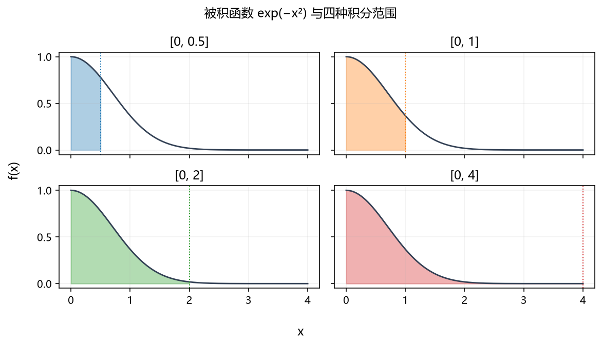
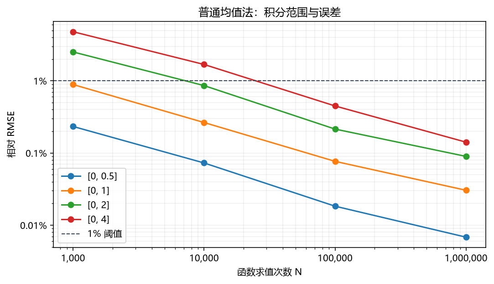
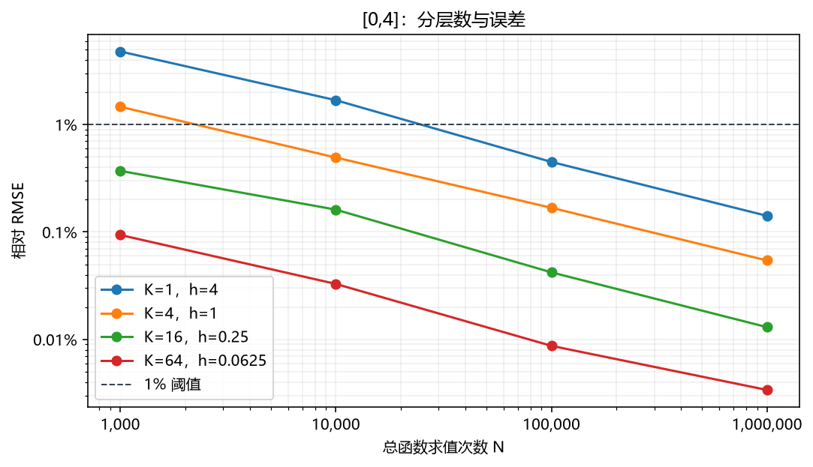
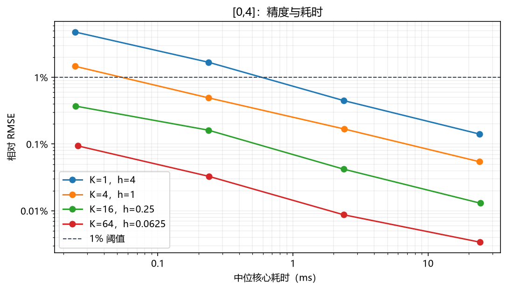

# 蒙特卡洛积分：抽样次数、积分范围与分层区间大小的影响

## 一、实验目的与函数选择

用蒙特卡洛算法计算超越函数 $f(x)=e^{-x^2}$ 的定积分。它没有初等原函数，但在有限区间内连续，定积分存在，也可用误差函数表示。本实验比较四种整体积分范围和四种总样本预算，再固定同一个积分目标，比较四种等宽分层。

参考值用 Python 的 `math.erf` 计算，并与独立实现的自适应 Simpson 积分交叉核对。

$$I(a,b)=\frac{\sqrt{\pi}}{2}\left(\mathrm{erf}(b)-\mathrm{erf}(a)\right)$$

Simpson 从整段和两个半段的近似差估计局部误差，满足误差判据后做校正，否则递归平分容差。绝对容差设为 1e-13，两种参考计算的允许差为 5e-13。下表数值均受浮点舍入影响，只用于计时外的核对和误差统计。

| 区间 | erf 参考值 | 自适应 Simpson | 绝对差 |
| --- | --- | --- | --- |
| [0,0.5] | 0.4612810064127924 | 0.4612810064127925 | 5.55e-17 |
| [0,1] | 0.7468241328124270 | 0.7468241328124270 | 0.00e+00 |
| [0,2] | 0.8820813907624215 | 0.8820813907624216 | 1.11e-16 |
| [0,4] | 0.8862269117895688 | 0.8862269117895689 | 1.11e-16 |



## 二、算法设计与核心实现

普通均值法取独立的均匀样本 X，使用 Welford 算法累计函数值的均值与离均差平方和 M2。令 L=b−a，样本方差为 M2/(N−1)，则

$$\widehat{I}=L\overline{f},\qquad \widehat{\mathrm{SE}}^2=L^2s^2/N.$$

等宽分层固定 L，取 h=L/K，第 j 层起点为 a+jh。把 N 除以 K 得商和余数，前 N mod K 层各多取一次。各层至少两次求值，以估计层内样本方差。分层估计与标准误差按各层单独汇总，分别为

$$\widehat{I}=\sum_j h\overline{f}_j,\qquad \widehat{\mathrm{SE}}^2=\sum_j h^2s_j^2/n_j.$$

近似 95% 区间为估计值加减 1.96 倍估计标准误差。它依赖大样本近似和 SE 估计，单次试验可能不覆盖参考值。分层中每层样本同分布，不同层的均值和方差一般不同，因此使用各层方差的加权和。

```text
设 h = (b-a)/K，estimate = variance = 0
对 j = 0 到 K-1
    count = N/K + (j < N mod K)，其中 N/K 取整数商
    初始化 count_seen、mean、M2 为 0
    重复 count 次
        u = uniform()，x = a + j*h + h*u，y = exp(-x*x)
        count_seen += 1，delta = y - mean
        mean += delta / count_seen
        M2 += delta * (y - mean)
    estimate += h * mean
    variance += h*h * (M2/(count-1)) / count
输出 estimate 和 sqrt(variance)
```

核心代码位于 [integral.hpp](../src/integral.hpp)。K=1 直接复用同一个循环，宽度为 L，固定种子产生相同的抽样序列、估计和 SE。每层结束后即可丢弃该层的累计变量，代码不保存样本点，也不存储长度为 K 的数组。

## 三、无偏性、方差与复杂度

在理想独立连续均匀抽样模型下，均值法满足 L 乘以函数值的期望等于目标积分。分层法中，h 乘以层内函数值期望等于该层积分，各层相加仍是同一个目标积分。因此两种估计都无偏。程序用伪随机数、离散网格和浮点计算实现这一模型。

令 $\sigma_j^2$ 为第 j 层的函数值总体方差。由层间独立，分层估计方差为 $\sum_j h^2\sigma_j^2/n_j$。用样本方差替换总体方差得到方差估计，并对它开方得到 SE。普通均值法的真实方差为 $L^2\sigma^2/N$，因此理论 RMSE 按 $N^{-1/2}$ 缩小。

当固定 K 并增加 N 时，各层样本量约为 N/K，分层法同样具有 $N^{-1/2}$ 的误差阶。改变 K 会改变层内方差。等额分配时，全方差公式把普通抽样的方差分成层内和层间两项，等宽分层去掉层间均值差异引起的那一项。本函数在 [0,4] 上导数有界，缩小 h 会限制每层函数值的变化范围。预算固定时，每层也会分到更少样本，层内方差估计会更依赖小样本，并最终受每层至少两点的约束。

均值法时间 O(N)，辅助空间 O(1)。分层法每次求值的工作为常数，每层另有常数开销，所以时间 O(N+K)，辅助空间 O(1)。批处理驱动按行读取任务，其文件解析和结果持久化在核心计时外。

## 四、环境、配置与计时口径

| 项目 | 实际记录 |
|---|---|
| 系统与架构 | Windows-11-10.0.26100-SP0，AMD64 |
| 处理器标识 | Intel64 Family 6 Model 190 Stepping 0, GenuineIntel |
| 编译器 | g++ (Rev5, Built by MSYS2 project) 16.1.0 |
| Python | 3.12.10 |
| 编译命令 | `g++ -std=c++17 -O2 -Wall -Wextra src/driver.cpp -o build/integral.exe` |
| 引擎 | std::mt19937_64 |
| 正式主种子 / 调度种子 | 2026112401 / 2026112402 |
| 复验主种子 / 调度种子 | 2026112403 / 2026112404 |

取引擎输出的高 52 位，使用中点映射 `(double(rng() >> 12) + 0.5) * 2^-52` 生成开区间 (0,1) 内的均匀数。每个任务有一个派生的 64 位种子，初始化一次引擎。预热和测量各自按配置与试验号生成种子，再分别打乱顺序。复验另用独立主种子和调度种子，派生种子与主实验及预热均不重复。每次种子、执行顺序及编译命令记录在任务表和运行清单中。

实验 A 使用 [0,0.5]、[0,1]、[0,2]、[0,4] 和普通均值法。实验 B 固定 [0,4]，比较 K=1、4、16、64，对应宽度 4、1、0.25、0.0625。两组总 N 都取 1,000、10,000、100,000、1,000,000，每配置预热 2 次后测量 50 次。A、B 的 [0,4]、K=1 共 200 条测量标为 A+B，仅执行一次。主实验记录 28 个独立配置、1400 条测量。

用 C++ 的 steady_clock 围住估计函数。用时含均匀数生成、区间映射、exp 求值、Welford 累计、分层管理、估计值和 SE 的合并。验证参数、初始化引擎、I/O、Python 调度、参考值、误差和区间分析均在计时外。估计量和样本数实际校验后写出 CSV。比较用每次估计的核心耗时中位数，ns/sample 等于该中位数除以总 N。

## 五、功能检查

PASS 50 C++ checks，另有 10 类非法输入通过拒绝检查。常数函数的积分等于区间长度乘常数，SE 为零。注入确定性均匀值，在 [1,5] 用线性函数核对映射、积分 12、积分估计方差 4/3 及余数分配。四种默认区间都检查了固定种子复现，以及 K=1 与独立写出的普通均值循环一致。

参考值的四次交叉核对最大绝对差为 1.11e-16。快速模式走通了同一构建与实验流程。正式审计重新计算参考值、任务种子、误差、覆盖率和汇总，并核对 CSV 哈希。正式 28 组的覆盖率实测介于 88% 和 100%，每组只有 50 次，覆盖率以 2 个百分点为步长波动。

## 六、实验 A：范围与抽样次数

精度门槛预先设为跨重复相对 RMSE 不超过 1%。相对 RMSE 等于各次平方误差平均值开方后除以本区间参考积分的绝对值。下表为实测百分比，斜率为四个 log(N) 与 log(相对 RMSE) 点的最小二乘拟合。

| 区间 | N=1,000 | N=10,000 | N=100,000 | N=1,000,000 | 最小达标 N | 斜率 |
| --- | --- | --- | --- | --- | --- | --- |
| [0,0.5] | 0.2332% | 0.0728% | 0.0183% | 0.0068% | 1,000 | -0.520 |
| [0,1] | 0.8886% | 0.2644% | 0.0766% | 0.0305% | 1,000 | -0.493 |
| [0,2] | 2.5110% | 0.8589% | 0.2145% | 0.0897% | 10,000 | -0.494 |
| [0,4] | 4.7855% | 1.6843% | 0.4485% | 0.1413% | 100,000 | -0.516 |



四条曲线的经验趋势接近理论斜率 −0.5。小范围内函数较平坦，普通均值法的相对误差也较低。把 [0,4] 改成 [0,0.5] 会改变待求积分，不能作为原积分的提速方案。只有固定 [0,4] 的实验 B 可以直接比较分层大小的代价和收益。

## 七、实验 B：固定目标下的分层区间大小

| N | K | h | 相对 RMSE | 平均 SE | 覆盖率 | 中位耗时（ms） | ns/sample | 达标 |
| --- | --- | --- | --- | --- | --- | --- | --- | --- |
| 1,000 | 1 | 4 | 4.7855% | 0.0415 | 94% | 0.02430 | 24.30 | 否 |
| 1,000 | 4 | 1 | 1.4640% | 0.0143 | 100% | 0.02440 | 24.40 | 否 |
| 1,000 | 16 | 0.25 | 0.3706% | 0.00359 | 98% | 0.02460 | 24.60 | 是 |
| 1,000 | 64 | 0.0625 | 0.0938% | 0.000894 | 94% | 0.02560 | 25.60 | 是 |
| 10,000 | 1 | 4 | 1.6843% | 0.0131 | 90% | 0.23655 | 23.66 | 否 |
| 10,000 | 4 | 1 | 0.4926% | 0.0045 | 94% | 0.23705 | 23.70 | 是 |
| 10,000 | 16 | 0.25 | 0.1614% | 0.00114 | 90% | 0.23690 | 23.69 | 是 |
| 10,000 | 64 | 0.0625 | 0.0329% | 0.000284 | 92% | 0.23810 | 23.81 | 是 |
| 100,000 | 1 | 4 | 0.4485% | 0.00415 | 98% | 2.37265 | 23.73 | 是 |
| 100,000 | 4 | 1 | 0.1680% | 0.00142 | 96% | 2.40235 | 24.02 | 是 |
| 100,000 | 16 | 0.25 | 0.0421% | 0.00036 | 94% | 2.37000 | 23.70 | 是 |
| 100,000 | 64 | 0.0625 | 0.0087% | 9.03e-05 | 100% | 2.37285 | 23.73 | 是 |
| 1,000,000 | 1 | 4 | 0.1413% | 0.00131 | 94% | 24.04435 | 24.04 | 是 |
| 1,000,000 | 4 | 1 | 0.0543% | 0.00045 | 96% | 24.09410 | 24.09 | 是 |
| 1,000,000 | 16 | 0.25 | 0.0130% | 0.000114 | 94% | 24.33505 | 24.34 | 是 |
| 1,000,000 | 64 | 0.0625 | 0.0034% | 2.86e-05 | 90% | 24.25275 | 24.25 | 是 |





相同 N 下，层数增加显著降低了本实验的相对 RMSE，主要计算量仍来自 N 次函数求值。同一个 K 下，提高 N 也会降低误差，但耗时随求值次数增长。完整估计均值、偏差、MAE、RMSE、平均 SE 和覆盖率见 [主实验汇总](../results/main_summary.csv)。

## 八、推荐配置与独立复验

先筛选主实验达标的 [0,4] 配置，再按中位耗时排序。把中位耗时在最快设置 10% 以内的组一并复验，避免只凭短时测量的小差距选一个赢家。每组用 50 个新种子，共 100 条复验测量。复验结果单独统计。

| N | K | 主实验 RMSE（相对） | 复验 RMSE（相对） | 主实验 μs | 复验 μs | 复验覆盖率 | 复验达标 |
| --- | --- | --- | --- | --- | --- | --- | --- |
| 1000 | 16 | 0.3706% | 0.3857% | 24.6 | 27.3 | 96% | 是 |
| 1000 | 64 | 0.0938% | 0.1021% | 25.6 | 28.3 | 96% | 是 |

主实验在 13 个达标配置中，N=1,000、K=16 的中位耗时最低，为 24.6 μs。共 2 组进入独立复验，其中 2 组达标。按主实验中位耗时，优先试用 N=1,000、K=16（h=0.25）。更重视精度时可选 N=1,000、K=64（h=0.0625）。后者主实验中位耗时相对前者高 4.1%，复验相对 RMSE 为 0.1021%。这点耗时差不足以确认唯一赢家。

## 九、局限与复现

以上推荐针对本机、该被积函数、已测 N/K 和 1% 门槛。RMSE 与覆盖率来自有限重复，排序也可能随系统调度、频率或编译器变化。固定 K 下的拟合用于观察趋势，改变 K 还会改变方差常数。对更窄的层、不同的函数或更严格的容差，需要重新比较。

使用 [README](../README.md) 中的 PowerShell 命令复现。原始估计值和逐次误差见 [主实验原始结果](../results/main_raw.csv)，独立种子和结果见 [复验汇总](../results/confirmation_summary.csv)。运行清单保留全部任务配置和哈希。PDF 使用与前三次同类的 Markdown 中文排版，内嵌公式和实验图。
