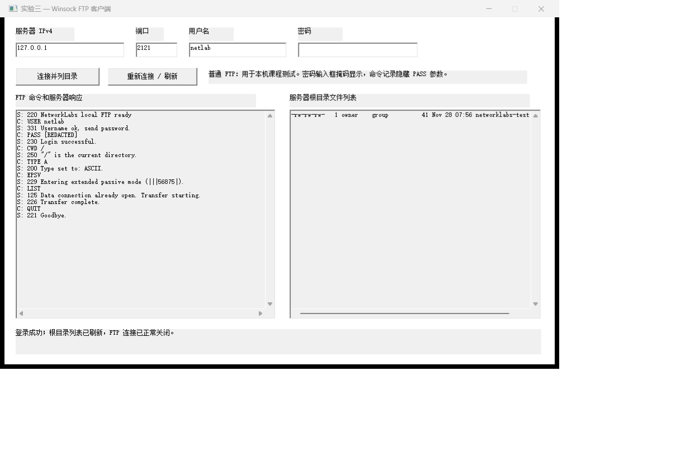

# 实验三：Windows Socket 编程

实验日期：2026-11-28（Asia/Shanghai）。状态：**TCP 与图形 FTP 已构建、运行并验证**。姓名、学号和班级留空。

## 实验目的

理解 TCP/IP 协议栈及客户机/服务器模式；使用 Winsock 流套接字完成独立进程通信；用 C++ 和 Win32 API 实现可输入连接参数、显示 FTP 命令/响应和根目录列表的图形客户端。

## 实验原理

TCP 建连和字节流收发与实验二相同，本实验保留自己的 lab03_server、lab03_client 入口与验证记录。FTP 控制连接用于文本命令和三位数字响应，LIST 的文件列表通过独立数据连接传送。EPSV/PASV 告知被动数据端口，客户端先连接数据端口，再发送 LIST，读取数据直至 EOF，并验证最终 226 响应。

Win32 界面使用窗口过程与消息循环，网络工作线程通过 PostMessage 将结果交给 UI 线程。窗口控件只在 UI 线程更新，避免网络等待阻塞用户操作。

## 实验设计过程

第一部分：src/server.cpp 与 src/client.cpp 复用 common/chat.hpp，但目标与实验二独立，默认端口 9326。socket 和 Winsock 由 RAII 释放；线程使用结束标志并 join，/quit 执行 shutdown。

第二部分：src/ftp_gui.cpp 构建为 Win32 GUI 目标 lab03_ftp，FTP 协议在 src/ftp.hpp 实现。输入字段包括 IPv4、端口、用户名和掩码密码；提供连接/列目录与刷新按钮。控制记录和根目录列表分栏显示，状态栏显示成功或失败。界面没有密码明文日志，也不把密码作为命令行参数。

发送顺序为 USER、PASS、CWD /、TYPE A、EPSV、LIST、QUIT；不支持 EPSV 时回退 PASV。多行响应以相同响应码加空格结尾；读取有长度限制。数据连接复用输入的服务器地址，不信任 PASV 指定的其他主机。PASS 参数固定脱敏，服务器响应和列表也检查并替换已知密码。

复用本机 pyftpdlib 2.2.0，监听 127.0.0.1:2121，FTP 根目录 D:\NetworkLabs\ftp-root，文件 networklabs-test.txt。凭据从当前 Windows 用户的 DPAPI 加密文件获取；未放入仓库或报告。普通 FTP 用于本机课程测试。

## 实验实现及结果分析

所有目标以 MSVC x64 Debug 成功构建，链接 Ws2_32.lib；GUI 另链接 User32 和 Gdi32。运行方法：

```powershell
.\out\build\msvc-x64\Debug\lab03_server.exe 9326
.\out\build\msvc-x64\Debug\lab03_client.exe 127.0.0.1 9326
.\out\build\msvc-x64\Debug\lab03_ftp.exe
```

TCP：以两个可见控制台运行实际独立进程，脚本定时输入，端口 19426。服务端首先主动发送 `server-first-in-console`，客户端收到；客户端主动发送 `client-first-in-console`，服务端收到；双方第二条消息也正确收到。客户端 /quit 后双方输出 SESSION CLOSED，退出码均为 0。verify_tcp.py 对 lab03 另测长消息、分帧、双方退出和连接失败，均通过。

FTP：verify_ftp_gui.py 操作真实 Win32 窗口控件，输入从本机读取的测试凭据，点击连接按钮并读取可见结果，不绕过 GUI 调用协议模块。实测如下。

| 场景 | 实际结果 |
|---|---|
| 正确账号登录 | USER→331、PASS→230，通过 |
| 根目录列表 | CWD /→250，TYPE A→200，EPSV→229，LIST→125、226，列表含 networklabs-test.txt |
| 正常断开 | QUIT→221，通过 |
| 密码保护 | 密码框掩码；记录显示 PASS [REDACTED]；日志、状态、列表中均不含测试密码 |
| 密码错误 | 服务器返回 530，状态栏显示操作失败 |
| 未监听端口 | 状态栏显示 Connection failed；旧文件列表清空 |
| 服务器接受连接后不发欢迎信息 | 接收超时后提示失败；等待期间 UI 对 WM_NULL 的往返响应在 250 ms 限制内 |

精简协议记录、测试汇总和客户端实际窗口截图放在 ../evidence/。原始完整测试输出保留在 out/verification。截图前已清空密码字段，未截取其他应用窗口。



## 问题及解决方案、心得体会

本地 FTP 服务对错误密码会延迟响应；最初 3 秒接收超时可能先于 530 返回。将控制通道超时调整为 5 秒后，真实界面测试能显示 530。连接建立仍限时 3 秒；读取前检查总操作时间，输入长度、响应长度和目录长度也设上限。慢服务器测试验证了后台线程设计确实使窗口保持响应。

测试 GUI 时，跨进程读取 Edit 内容必须用 WM_GETTEXT，GetWindowText 不能可靠读取其他进程的 Edit 控件；调整测试驱动后验证了真实显示内容。所有报告只依据成功的实际断言和输出，不把测试驱动初期失败写成程序通过。

限制：普通 FTP、IPv4、一次操作一次连接；没有实现 FTPS、上传下载和持久命令会话。该范围满足本次指导书的登录、命令响应及根目录列表要求。
